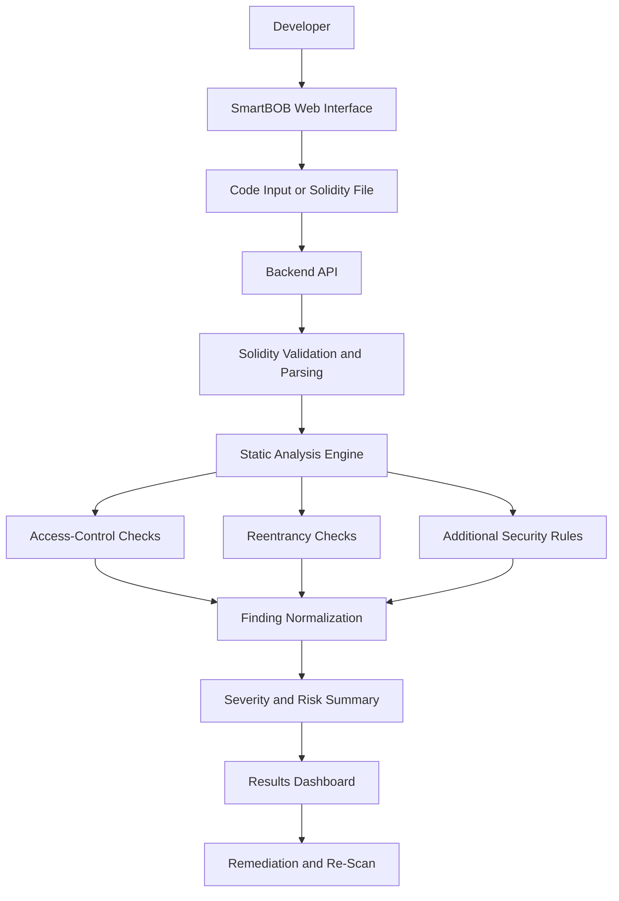

# 🔬 SmartBOB – Microscope
### Contract Under the Microscope | Smart Contract Vulnerability Scanner

<p align="center">
  <strong>Find vulnerabilities before they become exploits.</strong>
</p>

<p align="center">
  A developer-focused security scanner designed to help identify common smart contract vulnerabilities before deployment.
</p>

<p align="center">
  
  
  
  
</p>

---

## 📌 Table of Contents

- [Overview](#-overview)
- [Problem Statement](#-problem-statement)
- [Our Solution](#-our-solution)
- [Key Features](#-key-features)
- [Vulnerability Detection](#-vulnerability-detection)
- [System Architecture](#-system-architecture)
- [Technology Stack](#-technology-stack)
- [How It Works](#-how-it-works)
- [Project Structure](#-project-structure)
- [Installation and Setup](#-installation-and-setup)
- [Usage](#-usage)
- [API Reference](#-api-reference)
- [Sample Vulnerability Report](#-sample-vulnerability-report)
- [Security and Limitations](#-security-and-limitations)
- [Future Enhancements](#-future-enhancements)
- [Contributing](#-contributing)
- [Team](#-team)
- [License](#-license)

---

## 🚀 Overview

**SmartBOB – Microscope** is a smart contract security scanning platform built to help developers identify potentially dangerous coding patterns in Solidity smart contracts before they are deployed to a blockchain.

Smart contracts often control digital assets, tokens, financial transactions, and decentralized applications. A single vulnerability can expose these systems to unauthorized access, asset loss, or unexpected contract behavior.

SmartBOB aims to make security analysis more accessible by presenting potential vulnerabilities through an understandable interface with severity levels, code locations, explanations, and remediation guidance.

### Project Details

| Attribute | Description |
|---|---|
| Project Name | SmartBOB – Microscope |
| Tagline | Contract Under the Microscope |
| Project Category | Blockchain and Web3 Security |
| Application Type | Smart Contract Vulnerability Scanner |
| Primary Smart Contract Language | Solidity |
| Main Security Focus | Access Control and Reentrancy |
| Additional Focus | Common Solidity security weaknesses and logic-related risks |
| Target Users | Smart contract developers, Web3 startups, DeFi teams, security researchers |
| Repository | [smartBOB_Microscope](https://github.com/chinmay-R-bat/smartBOB_Microscope.git) |

## ❗ Problem Statement

Smart contracts are designed to execute blockchain operations according to predefined rules. However, vulnerabilities in their code can allow attackers to bypass permissions, manipulate execution flows, or exploit external calls.

Traditional security audits can require considerable time, expertise, and financial resources. Small development teams may lack access to continuous professional auditing, leaving potentially dangerous code undetected until deployment.

Two particularly important vulnerability classes are:

1. **Access-control failures:** Unauthorized users gain access to privileged functions or sensitive operations.
2. **Reentrancy:** An external call allows execution to re-enter a contract before its previous operation has completed safely.

Logic errors and other unsafe coding patterns can create additional security risks.

### Why This Matters

| Challenge | Potential Consequence |
|---|---|
| Missing access restrictions | Unauthorized administrative actions |
| Unsafe external calls | Reentrant execution and potential asset loss |
| Incorrect state updates | Inconsistent contract state |
| Unchecked low-level calls | Failed operations may go unnoticed |
| Complex contract logic | Difficult-to-identify security weaknesses |
| Limited auditing budgets | Vulnerabilities may remain undetected before deployment |

**Our objective:** provide developers with an accessible first layer of security analysis before they ship their smart contracts.

## 💡 Our Solution

SmartBOB – Microscope provides a developer-oriented workflow for inspecting Solidity source code and identifying suspicious patterns.

The platform is designed around the following workflow:

1. Submit Solidity code through the scanner interface.
2. Analyze the submitted code using the detection mechanisms implemented by the project.
3. Identify potential security issues.
4. Display findings with severity, affected code locations, and explanations.
5. Provide recommendations to help developers investigate and correct the identified issues.
6. Re-scan the updated contract to evaluate whether the reported patterns remain.

The goal is to turn complex security findings into actionable information that developers can understand and use.

## ✨ Key Features

| Feature | Description |
|---|---|
| Solidity Code Analysis | Accepts smart contract source code for inspection. |
| Access-Control Analysis | Looks for potentially unsafe authorization patterns. |
| Reentrancy Analysis | Examines relevant external-call and state-update patterns. |
| Severity Classification | Organizes findings by risk level where supported. |
| Code-Level Findings | Identifies the affected function or source location where available. |
| Security Explanations | Helps developers understand why a pattern may be dangerous. |
| Remediation Guidance | Suggests safer coding practices for identified issues. |
| Risk Summary | Summarizes the findings from a scan. |
| Developer-Friendly Interface | Presents security information in an accessible format. |
| Extensible Detection Engine | Allows additional vulnerability checks to be added over time. |

*Note: Feature descriptions should be aligned with the functionality currently implemented in the repository. A planned feature should not be presented as a completed feature until it has been tested.*

## 🛡️ Vulnerability Detection

SmartBOB prioritizes vulnerability categories that can have serious consequences for blockchain applications.

| Vulnerability | Description | Potential Impact | Detection Focus |
|---|---|---|---|
| Access-Control Failure | A privileged operation lacks sufficient authorization checks. | Unauthorized withdrawals, configuration changes, or administrative actions. | Function visibility, role checks, and authorization patterns. |
| Reentrancy | An external interaction permits a function to be entered again before the initial operation safely completes. | Unexpected state changes or loss of assets. | External calls, state updates, and execution order. |
| Unchecked Low-Level Calls | The result of a low-level call is not handled appropriately. | Failed operations may be treated as successful. | Return-value handling and call patterns. |
| `tx.origin` Authentication | Transaction origin is used in an authorization decision. | Potential phishing and authorization bypass scenarios. | Authentication conditions involving `tx.origin`. |
| Unsafe `delegatecall` | External code executes in the caller's storage context. | Storage corruption or unauthorized control. | Delegate-call targets and trust boundaries. |
| Logic Errors | Contract behavior does not match its intended business rules. | Incorrect balances, unexpected permissions, or broken invariants. | Rule-specific checks and manual review. |

**Important:** Detection coverage depends on the rules and analysis engine implemented in the current version. The table describes the intended security scope, not a guarantee that every listed vulnerability is automatically detected.

### Severity Classification

| Severity | Meaning | Recommended Action |
|---|---|---|
| Critical | A confirmed or potentially severe issue could compromise assets or contract control. | Stop deployment and investigate immediately. |
| High | A significant vulnerability may enable unauthorized actions or major state manipulation. | Prioritize remediation. |
| Medium | An issue may create security risks under specific conditions. | Investigate and fix before production. |
| Low | A weakness or unsafe pattern has limited or conditional impact. | Review and improve. |
| Informational | A security observation or best-practice recommendation. | Evaluate as part of code review. |

Severity should be assigned using the project's actual classification logic and the context of each finding.

## 🏗️ System Architecture

The scanner can be organized into the following logical components:



### Architecture Components

| Component | Responsibility |
|---|---|
| Frontend | Collects contract source code and displays scan results. |
| Backend API | Validates scan requests and coordinates analysis. |
| Solidity Validation | Checks source-code validity and compiler compatibility where configured. |
| Static Analysis Engine | Examines the contract using implemented security rules or analysis tools. |
| Detection Rules | Identify potentially vulnerable coding patterns. |
| Finding Processor | Structures findings into a consistent format. |
| Results Dashboard | Displays detected issues, their severity, and relevant explanations. |
| Optional Database | Stores scan history or user information if persistence is implemented. |

The diagram represents the logical architecture. Specific components, integrations, and data-storage behavior depend on the implementation in the repository.

## 🧰 Technology Stack

The following table describes the project's intended development stack. Verify the actual dependencies in `package.json`, the backend configuration, and the lockfiles before treating every item as part of the released build.

| Technology | Purpose |
|---|---|
| React | Component-based frontend interface |
| TypeScript | Type-safe application development |
| Vite | Frontend development server and build tooling |
| Node.js | JavaScript runtime for backend services |
| Solidity | Smart contract source language being analyzed |
| Solidity Compiler (`solc`) | Compilation and source validation where configured |
| Static Analysis Rules or Tools | Automated security-pattern analysis |
| Supabase / PostgreSQL | Optional authentication and scan-history storage |
| Ethers.js | Optional Ethereum interaction and contract-related utilities |
| Git and GitHub | Version control and collaboration |

### Why Static Analysis?

Static analysis inspects code without requiring the contract to be deployed or executed in a live blockchain environment.

| Static Analysis | Live Deployment Testing |
|---|---|
| Can inspect source code before deployment. | Requires a deployed or locally running contract environment. |
| Can flag suspicious patterns early. | Can reveal behavior during specific execution scenarios. |
| Supports repeatable automated checks. | Depends on test scenarios and runtime conditions. |
| Cannot prove the absence of every vulnerability. | Also cannot prove the absence of every vulnerability. |

Static analysis is most useful as one part of a broader security process that also includes testing, manual review, and independent auditing.

## ⚙️ How It Works

### Step 1 — Submit a Contract

The developer provides Solidity source code through the web interface or an available file-upload mechanism.

### Step 2 — Validate the Input

The application checks whether the submitted input meets the scanner's requirements. Compiler-based validation may be used if configured.

### Step 3 — Analyze the Code

The analysis engine examines the source code using the detection rules available in the application.

### Step 4 — Generate Findings

Detected issues are converted into structured findings containing the available information, such as:

- Vulnerability category
- Severity
- Affected function or source location
- Explanation of the risk
- Recommended remediation

### Step 5 — Review and Improve

The developer reviews the findings, modifies the contract, and runs another scan.

### Step 6 — Validate Before Deployment

The updated contract should undergo appropriate unit tests, security testing, and independent review before production deployment.

## 📂 Project Structure

The exact directory structure should reflect the files currently present in the repository. A typical full-stack organization for this project could look like this:

```text
smartBOB_Microscope/
├── frontend/
│   ├── public/
│   ├── src/
│   │   ├── components/
│   │   ├── pages/
│   │   ├── services/
│   │   ├── types/
│   │   ├── App.tsx
│   │   └── main.tsx
│   ├── package.json
│   └── vite.config.ts
│
├── backend/
│   ├── src/
│   │   ├── routes/
│   │   ├── controllers/
│   │   ├── analyzer/
│   │   ├── rules/
│   │   └── server.ts
│   └── package.json
│
├── contracts/
│   └── examples/
│
├── tests/
├── .env.example
├── .gitignore
└── README.md
```

This is a **suggested structure**, not a verified inventory of the current repository. Adjust it to match the actual folders and filenames.

## 💻 Installation and Setup

### Prerequisites

| Requirement | Purpose |
|---|---|
| Git | Clone the repository |
| Node.js | Run the frontend and Node.js backend, if used |
| npm | Install JavaScript dependencies |
| Solidity compiler | Validate or compile Solidity contracts if required |
| Supabase project | Required only if the application uses Supabase |

### 1. Clone the Repository

```bash
git clone https://github.com/chinmay-R-bat/smartBOB_Microscope.git
cd smartBOB_Microscope
```

### 2. Install Dependencies

If the frontend and backend have separate `package.json` files:

```bash
cd frontend
npm install
```

Then install backend dependencies:

```bash
cd ../backend
npm install
```

If the repository uses a single root-level `package.json`, follow its scripts and install instructions instead.

### 3. Configure Environment Variables

If environment variables are required, create the appropriate `.env` file using the keys documented in `.env.example`.

Example:

```env
PORT=5000
```

Add only the environment variables actually required by your implementation.

**Security note:** Never commit private API keys, database service-role keys, wallet private keys, or other secrets to GitHub. Frontend environment variables must not contain server-side secrets.

### 4. Start the Backend

From the backend directory, use the start command defined in its `package.json`. For example, if the project defines a development script:

```bash
npm run dev
```

### 5. Start the Frontend

From the frontend directory:

```bash
npm run dev
```

Open the local URL printed by Vite in the terminal, commonly `http://localhost:5173`.

> The commands above assume a conventional frontend/backend setup. Use the actual scripts and directory names in the repository if they differ.

## 🖥️ Usage

1. Open the SmartBOB – Microscope application.
2. Navigate to the smart contract scanning interface.
3. Paste the Solidity source code or upload a file if supported.
4. Start the security scan.
5. Review the findings and their severity.
6. Read the explanations and remediation recommendations.
7. Correct the relevant code.
8. Run the scan again and perform additional security tests.

### Example Solidity Code

The following simplified example illustrates a potentially unsafe authorization pattern:

```solidity
// SPDX-License-Identifier: MIT
pragma solidity ^0.8.20;

contract UnsafeVault {
    address public owner;

    constructor() {
        owner = msg.sender;
    }

    function withdrawAll(address payable recipient) external {
        // Vulnerability: no owner authorization check.
        recipient.transfer(address(this).balance);
    }

    receive() external payable {}
}
```

The `withdrawAll` function permits any caller to request a withdrawal to an address of their choice. A scanner with a suitable access-control rule should flag the missing authorization check.

A simplified remediation is:

```solidity
modifier onlyOwner() {
    require(msg.sender == owner, "Not authorized");
    _;
}

function withdrawAll(address payable recipient)
    external
    onlyOwner
{
    recipient.transfer(address(this).balance);
}
```

This example illustrates the intended analysis workflow. It is not a claim that the current scanner has already detected or tested this exact contract.

## 🔌 API Reference

If the backend exposes an HTTP API, document its actual endpoints here. The following is a suggested interface for a source-code scanning endpoint.

### Scan Contract

| Property | Value |
|---|---|
| Method | `POST` |
| Endpoint | `/scan` |
| Content Type | `application/json` |
| Purpose | Submit Solidity source code for analysis |

### Example Request

```json
{
  "source_code": "pragma solidity ^0.8.20; contract Example {}"
}
```

### Example Response

```json
{
  "status": "completed",
  "findings": [
    {
      "type": "access-control",
      "severity": "high",
      "title": "Missing authorization check",
      "location": {
        "function": "withdrawAll"
      },
      "description": "A privileged operation may be callable by an unauthorized user.",
      "recommendation": "Add and verify an appropriate access-control mechanism."
    }
  ]
}
```

The request and response above define an illustrative API contract. They are **not verified live API responses**. Update the endpoint, payload, field names, status codes, and response format to match the actual backend implementation.

## 📊 Sample Vulnerability Report

A scan report can present findings in a table like the following:

| ID | Vulnerability | Severity | Location | Recommended Action |
|---|---|---|---|---|
| SB-001 | Missing Access Control | High | Example: `withdrawAll()` | Add and verify authorization checks. |
| SB-002 | Potential Reentrancy | High | Example: External-call function | Review call ordering and state updates. |
| SB-003 | Unchecked Low-Level Call | Medium | Example: External interaction | Handle the call result and failure conditions. |

These rows are examples for documentation only, not measured results from the current application.

### Evaluation and Testing

To demonstrate that the scanner works, test it against contracts with known vulnerable patterns and corrected versions.

| Test Case | Expected Result |
|---|---|
| Contract with a missing owner check | Flag the issue if access-control detection is implemented. |
| Contract with a known reentrancy pattern | Flag the issue if reentrancy detection is implemented. |
| Contract with appropriate access control | Avoid the corresponding false positive where possible. |
| Corrected reentrancy example | Evaluate whether the original finding disappears. |
| Invalid Solidity source | Return a useful validation error if compiler validation is implemented. |

Track true positives, false positives, false negatives, and scan failures. These measurements provide stronger evidence than a demonstration using only one vulnerable example.

## 🔐 Security and Limitations

SmartBOB is intended to assist developers with early-stage security analysis. It must not be treated as a replacement for a professional smart contract audit.

| Consideration | Description |
|---|---|
| Detection Coverage | Only vulnerabilities covered by the implemented rules or analysis engine can be detected reliably. |
| False Positives | Some flagged patterns may be safe in their specific context. |
| False Negatives | A scanner may miss vulnerabilities that are not covered by its detection logic. |
| Business Logic | Complex protocol-specific flaws may require manual review and specialized testing. |
| Compiler Compatibility | Solidity versions and dependencies may affect analysis results. |
| Untrusted Source Code | Submitted contracts should be processed with appropriate resource limits and isolation. |
| Secrets | Private keys and credentials should never be embedded in contracts submitted for analysis. |
| Production Readiness | Scan results should be validated with tests and independent security review. |

### Responsible Use

- Scan contracts you own or are authorized to review.
- Review findings in context rather than relying solely on severity labels.
- Avoid deploying contracts solely because the scanner reports no findings.
- Do not submit sensitive credentials or private keys.
- Validate security fixes through tests and code review.

## 🚀 Future Enhancements

| Enhancement | Objective |
|---|---|
| Expanded Vulnerability Rules | Cover additional Solidity and smart contract weaknesses. |
| Improved Reentrancy Detection | Analyze more complex control flows and external interactions. |
| Advanced Access-Control Analysis | Evaluate role-based permissions and privileged function paths. |
| Vulnerable vs. Fixed Comparison | Show differences between original and corrected code. |
| Downloadable Reports | Export scan findings in JSON, PDF, or other supported formats. |
| Scan History | Allow users to compare earlier and later scans. |
| Automated Regression Tests | Verify that known vulnerable examples continue to trigger the expected findings. |
| CI/CD Integration | Run security checks during pull requests and deployment pipelines. |
| Compiler-Aware Analysis | Improve source mapping and compatibility with supported Solidity versions. |
| Testing and Benchmarking | Evaluate precision, recall, false positives, and false negatives against labeled examples. |

These items represent possible improvements and should be marked as completed only after implementation and testing.

## 🤝 Contributing

Contributions that improve security analysis, usability, testing, and documentation are welcome.

1. Fork the repository.
2. Create a feature branch.
3. Implement your changes.
4. Add or update tests for the relevant functionality.
5. Verify that existing tests pass.
6. Commit your changes with a clear message.
7. Open a pull request describing the change and its security implications.

For vulnerability reports, avoid publicly disclosing exploitable details before maintainers have had an opportunity to investigate.

## 👥 Team

**Project:** SmartBOB – Microscope

**Theme:** Contract Under the Microscope

**Focus:** Making smart contract security analysis more accessible to developers.

Repository: [chinmay-R-bat/smartBOB_Microscope](https://github.com/chinmay-R-bat/smartBOB_Microscope)

Add the team members, mentor, and acknowledgements here if required for the hackathon submission.

## 📜 License

A license has not been specified in this documentation template. Add the license that the project maintainers choose and include the corresponding `LICENSE` file before describing the project as open source.

---

<p align="center">
  <strong>SmartBOB – Microscope</strong><br/>
  Inspect the code. Identify the risk. Strengthen the contract.
</p>
