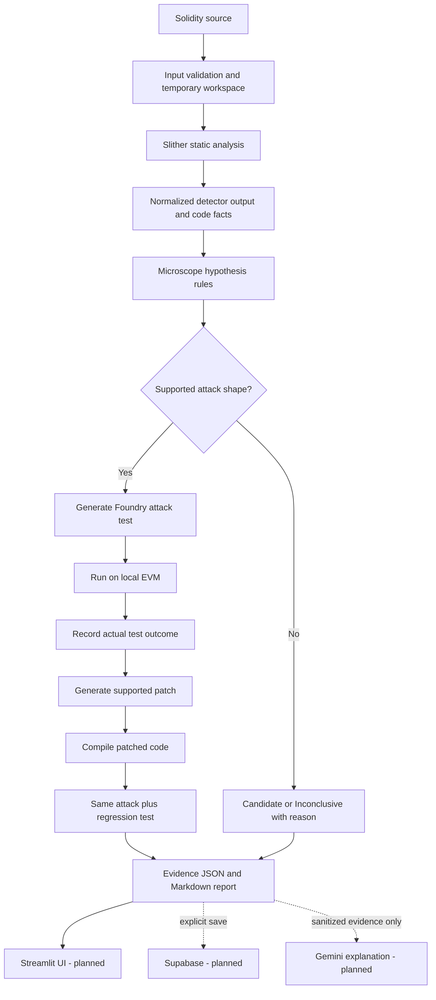

# Microscope

**Don't just flag suspicious smart-contract code. Try to reproduce the attack, then test the fix.**

Microscope is an evidence-driven security workbench for Solidity smart contracts. It is designed to combine static analysis with local attack testing and patch verification so developers can understand which issues are suspicious, which attacks were actually reproduced, and whether a proposed fix passed the required tests.

> **Status honesty:** This README separates the intended architecture from functionality that has been demonstrated. A feature is marked **Working** only when there is a recorded successful test or demo. Planned code and documentation do not count as working functionality.

---

## 1. Problem and scope

### Problem

Static-analysis tools can identify suspicious code, but a warning does not always prove that a real attack is possible. A contract with no reported findings is not necessarily safe, either. Developers need to understand the evidence behind a warning and, where possible, test the suspected behavior.

### Microscope's approach

Microscope aims to turn a static-analysis warning into an evidence-backed workflow:

1. **Detect:** run Slither and preserve its actual detector output.
2. **Investigate:** extract code facts and apply rules to generate a candidate or an inconclusive result.
3. **Reproduce:** for supported patterns, generate and run a Foundry attack test on a local EVM.
4. **Patch:** propose a limited, deterministic fix for supported cases.
5. **Verify:** rerun the same attack against the patched code and run a regression test.
6. **Explain:** render the stored evidence and optionally use Gemini to explain it in plain language.

### MVP scope

- **Language / platform:** Solidity and the EVM, focusing on Solidity 0.8.x and single-file or small-project cases.
- **Initial vulnerability classes:** ETH reentrancy and access-control failures.
- **Local security engine:** Python, Slither, Foundry and Solidity test templates.
- **UI target:** Streamlit.
- **Supporting services:** Supabase for authentication and saved-report data; Gemini for explanations only. These integrations are intended, but are not represented as implemented until verified.

### Out of scope for the MVP

The MVP does not aim to analyze every vulnerability class, guarantee contract safety, support every Solidity build setup, or replace a professional audit. Multi-chain support, Vyper, automatic GitHub import, CI/SARIF, broad fuzzing, and unrestricted arbitrary-contract patching are not core MVP requirements.

---

## 2. Approach and architecture

### Architecture diagram



The diagram describes the **target workflow**, not a claim that every stage is implemented. Current implementation status is listed in Section 3.

### Component responsibilities

| Component | Responsibility | Authority |
|---|---|---|
| Slither | Identify static-analysis signals and expose code facts | Supplies evidence; does not prove exploitability by itself |
| Microscope rules | Interpret code facts and generate hypotheses | May report `candidate` or `inconclusive` at the static stage |
| Foundry | Execute supported attack and regression tests on a local EVM | Executed outcomes determine whether the specified behavior was reproduced under that test |
| Patcher | Propose a deterministic fix for supported cases | A generated patch is not proof that the fix works |
| Regression test | Check expected legitimate behavior after a patch | Required alongside the repeated attack before `mitigated_in_test` |
| Streamlit | Display recorded findings and evidence | Must not invent findings, traces, or success states |
| Supabase | Authentication and saved report records | Optional persistence service; not the analysis engine |
| Gemini | Explain existing, sanitized evidence | Must not create findings or change evidence status |

### Evidence statuses

| Status | Meaning |
|---|---|
| `candidate` | Static evidence suggests a possible issue. This is not proof of exploitability. |
| `inconclusive` | Available facts, tooling, or the test harness cannot support a reliable conclusion. |
| `reproduced` | An executed test demonstrated the specified attack outcome. |
| `not_reproduced` | The attack did not succeed under this particular test. This does **not** prove safety. |
| `mitigated_in_test` | The same attack was blocked by the patch and the required regression test passed. |
| `regression_failure` | The attack still succeeds or the required regression test failed. |

Compilation errors, timeouts, missing tools, and malformed output must be represented as explicit errors or inconclusive results—not as successful scans with zero findings.

---

## 3. Core deliverables and current status

Statuses below reflect the latest results recorded during project preparation. Re-run the commands in this README in the current checkout before relying on them. **Working** means demonstrated by a reported real command/test; it does not mean the whole product is complete.

| Deliverable | Status | Where to see it / how to verify |
|---|---|---|
| Vulnerable and fixed reference contracts | **Working** | `src/vulnerable/VulnerableVault.sol`, `src/fixed/SafeVault.sol`, `src/vulnerable/VulnerableTreasury.sol`, `src/fixed/SafeTreasury.sol` |
| Reference Foundry attack tests | **Working — last reported run: 4 passed, 0 failed, 0 skipped** | `test/Exploits.t.sol`; verify with `forge test -vvv` |
| Local Slither installation and baseline detector output | **Working — manually demonstrated** | Run the Slither commands in Section 7 on the four reference contracts |
| Compiler-failure test fixtures | **Partial** | `BrokenVault.sol` and `BrokenTreasury.sol` were created as separate test fixtures for download; confirm they are added to the repository and exercise the actual app before calling error handling complete |
| Shared evidence schema (`scanner/schema.py`) | **Not done / not verified** | Planned location: `scanner/schema.py` |
| Slither API checks and structured facts (`api_check.py`, `facts.py`) | **Not done / not verified** | Planned locations: `scanner/api_check.py`, `scanner/facts.py` |
| Detector normalization and hypothesis rules | **Not done / not verified** | Planned locations: `scanner/detectors.py`, `scanner/hypotheses.py` |
| Automatically generated Foundry attacks and result parsing | **Not done / not verified** | Planned locations: `scanner/templates/`, `scanner/runner.py` |
| Deterministic patch generation and regression verification | **Not done / not verified** | Planned location: `scanner/patcher.py` |
| Unified evidence JSON/Markdown report | **Partial at tool-output level; Microscope pipeline not verified** | Raw Slither output can be generated with the commands in Section 7; planned module: `scanner/report.py` |
| Streamlit application | **Not done / not verified** | Planned entry point: `app.py` |
| Supabase authentication, report persistence and RLS | **Not done / not verified** | Intended integration; migrations, policies, and cross-user isolation must be implemented and tested |
| Gemini evidence explanation | **Not done / not verified** | Intended explanation-only integration; must not determine findings or statuses |
| End-to-end scan from UI through attack and patch verification | **Not done / not verified** | Requires the modules above and an actual recorded end-to-end test |

Do not change these labels to **Working** based on code generation alone. Update the table when a real command, automated test, or demonstrable application flow verifies the feature.

---

## 4. Stretch objectives

Stretch objectives are not part of the minimum working product. A status of **Working** should be used only when the objective has actually been demonstrated.

| Stretch objective | Status | Evidence / condition to mark Working |
|---|---|---|
| 12-contract benchmark with held-out evaluation | **Not done** | A real results file, documented labels, split methodology, and false-positive/missed-case analysis |
| Expanded attack templates beyond the supported reentrancy and access-control shapes | **Not done** | Tests showing each additional template on vulnerable and safe examples |
| Git/GitHub repository import | **Not done — out of MVP scope** | Safe retrieval, size limits, SSRF protections, and an end-to-end demo |
| Contract call-graph visualization | **Not done — out of MVP scope** | UI graph built from real analyzer output, with unsupported states handled honestly |
| Echidna or broader fuzz testing | **Not done — out of MVP scope** | Tool installed and a reproducible test run whose output is shown in the report |
| SARIF output and CI integration | **Not done — out of MVP scope** | Validated SARIF file and a real CI run |
| Multi-chain or Vyper support | **Not done — out of MVP scope** | Separate integration tests for the claimed chain or language |
| Mainnet analysis or deployment | **Not done — intentionally excluded from this MVP** | Not needed for the local, isolated workflow described here |

---

## 5. Threat model and intended users

### Intended users

- Solidity developers who want to investigate suspicious code.
- Students and security learners who need to see why a pattern may be risky.
- Reviewers who want a traceable record of static evidence, attack-test results, and patch-test results.

Microscope is a developer assistance and demonstration tool. It is not a replacement for a professional smart-contract audit.

### Assets to protect

- The user's Solidity source code and proprietary project details.
- Supabase credentials, Gemini API keys, and other secrets.
- Integrity of analyzer output, generated tests, patch diffs, and reports.
- Separation between different users' saved reports.
- Reliability of the local machine and temporary analysis workspace.

### Threats and mitigations

| Threat | Expected mitigation |
|---|---|
| Malformed or hostile Solidity input | Validate size, type, encoding, and paths; treat source and comments as untrusted data |
| Source attempts to exploit process invocation | Use subprocess argument lists, avoid `shell=True`, set timeouts, use controlled temporary directories, and clean up after execution |
| Slither/compiler/Foundry failure appears as a clean scan | Preserve exit codes and diagnostics; distinguish tool failure from a successful scan with no findings |
| False positive or false assurance | Preserve `candidate`, `inconclusive`, and `not_reproduced`; do not display a universal “safe” verdict |
| Fake or incomplete attack trace | Show replay only when a real trace is stored; missing artifact must be explicit |
| Invalid patch reported as fixed | Compile the patch, rerun the same attack, and run regression tests before `mitigated_in_test` |
| Exposure of source to cloud services | Keep analysis local by default; send Gemini only the minimum sanitized evidence needed for an explanation; do not retain source by default |
| One user accesses another user's saved reports | Use Supabase Row Level Security and test isolation with at least two different users before claiming this is protected |
| API key or service-role key leaks | Keep secrets server-side/in environment configuration; never bundle privileged keys in frontend code or commit them |

### Explicit trust boundaries

Solidity source is untrusted input, even if supplied by the user. Compiler and analysis processes are treated as fallible. Gemini output is untrusted explanatory text. Only structured tool evidence and actual test results may establish the statuses defined in Section 2.

---

## 6. Assumptions

1. **Toolchain:** The development environment is Windows 11 with Ubuntu on WSL2. The last recorded setup used Python 3.14.4, Slither 0.11.6, Foundry 1.8.5, and Solidity compiler 0.8.24 for the reference project.
2. **Compiler availability:** The appropriate Solidity compiler and dependencies must be installed for the submitted contract. Compilation failures must be reported, not silently bypassed.
3. **Input scope:** The MVP primarily targets Solidity 0.8.x and single-file or small projects. Complex dependency layouts, remappings, unusual build frameworks, proxies, and upgradeable patterns may not be supported.
4. **Supported vulnerability patterns:** Attack generation and patching only work for shapes implemented and tested in the templates. Other cases must remain candidates or become inconclusive with a reason.
5. **Local execution:** Slither and Foundry are intended to run locally with timeouts and temporary-workspace cleanup. The MVP does not need mainnet RPC access.
6. **Evidence is bounded:** A successful or unsuccessful test only describes the tested scenario. It does not establish general contract safety.
7. **Cloud services are supporting features:** Supabase and Gemini are intended integrations, but local analysis should not depend on either being available.
8. **Source retention:** Original source is not retained by default. Any saved report or optional explanation must follow an explicit, documented data-handling policy.
9. **Status reporting follows demonstration:** A planned module, a generated UI mockup, or a design document does not prove that an implementation works.
10. **Reference contracts are illustrative:** The four fixtures are test cases, not a representative measure of real-world detection accuracy.

---

## 7. Evidence: measurements and how to reproduce them

### 7.1 Reference test result

The last reported run of the existing Foundry reference tests was:

```text
4 passed, 0 failed, 0 skipped
```

The tests cover reproduction of the reentrancy and access-control examples against the vulnerable fixtures, and mitigation by the corresponding hand-written reference fixes. This result was reported during environment preparation; rerun the command in the current checkout to verify it again.

```bash
cd ~/microscope
forge test -vvv
```

**What this number means:** four reference tests passed in the prepared local environment. It is not a detection-accuracy score, not a benchmark result, and not evidence that all vulnerabilities can be detected.

### 7.2 Slither baseline observations

These detector observations were manually run and recorded during environment preparation:

| Contract | Recorded detector output | Interpretation |
|---|---|---|
| `VulnerableVault.sol` | `reentrancy-eth`, `low-level-calls` | Slither flags a reentrancy pattern in the vulnerable reference contract |
| `SafeVault.sol` | `low-level-calls` only | A low-level call warning alone must not be treated as a reentrancy finding |
| `VulnerableTreasury.sol` | `missing-zero-check`, `low-level-calls` | Slither did not directly flag the unprotected owner-change operation in this example |
| `SafeTreasury.sol` | `events-access`, `missing-zero-check`, `low-level-calls` | These warnings do not by themselves prove an access-control bypass |

Regenerate the current output rather than relying on old result files:

```bash
cd ~/microscope
source .venv/bin/activate

slither src/vulnerable/VulnerableVault.sol --json /tmp/microscope-vulnerable-vault.json
slither src/fixed/SafeVault.sol --json /tmp/microscope-safe-vault.json
slither src/vulnerable/VulnerableTreasury.sol --json /tmp/microscope-vulnerable-treasury.json
slither src/fixed/SafeTreasury.sol --json /tmp/microscope-safe-treasury.json
```

Check the command exit status and the JSON's success/error fields, if present. A JSON file being created does not by itself mean analysis succeeded.

### 7.3 Additional input-error fixtures

`BrokenVault.sol` and `BrokenTreasury.sol` were created as separate sample files with intentional Solidity syntax errors. Their end-to-end handling by the Microscope application has **not been demonstrated**. Once added to the repository, test that each produces a visible compilation/tool error, no fabricated clean scan, and no attack or patch result.

### 7.4 Benchmark and accuracy claims

No completed Microscope benchmark results are currently reported here. There are no verified precision, recall, false-positive-rate, false-negative-rate, or performance numbers for the integrated product. Those numbers must not be invented.

If a benchmark is implemented, publish the exact contract set, labels, tuning/held-out split, tool versions, commands, raw results, false positives, missed cases, and measurement method. A small self-authored sample should be described as illustrative, not statistically significant.

---

## 8. Known limitations and next steps

### Known limitations

- The integrated scanner pipeline and Streamlit interface are not verified as complete in the current documented status.
- The main planned vulnerability classes are ETH reentrancy and access control; other bug classes are outside the initial scope.
- Static-analysis rules may miss subtle authorization checks, unusual control flow, indirect calls, assembly, proxies, and complex project layouts.
- Recognizing a guard somewhere in a function's call/modifier closure does not necessarily prove that the guard dominates every path to a sensitive operation.
- Access-control inference can miss privileged variables when no recognized guard provides evidence of privilege.
- Generated attack tests cover only supported code shapes. Unsupported cases must be marked inconclusive rather than guessed.
- A failed or unsupported test cannot be interpreted as proof of safety.
- Deterministic template patches may not fit every contract and require compilation, attack retesting, and regression testing.
- Low-level-call warnings can be benign and must not be treated as reentrancy proof by themselves.
- The reference tests and four reference contracts are too small to support broad accuracy claims.
- Supabase authentication, RLS, saved-report behavior, Gemini explanations, and their security tests are not verified as implemented.
- Error-handling fixtures exist as examples, but their end-to-end behavior in the application is not yet verified.

### Next steps, in priority order

1. **P1 — Facts and hypotheses:** implement and test the shared schema, Slither API checks, fact extraction, detector normalization, and rules against both vulnerable and fixed fixtures. Include identifier-renaming tests to guard against name-based hardcoding.
2. **P2 — Attack tests:** generate supported Foundry tests, parse actual test output, and correctly distinguish reproduced, not reproduced, and inconclusive outcomes.
3. **P3 — Patch verification:** generate supported deterministic patches and require both same-attack and regression-test results.
4. **P4 — UI and reports:** implement Streamlit pages backed only by real stored evidence; add report export and honest error/empty states.
5. **Integration — Supabase and Gemini:** add authenticated saved-report records with RLS tests and a strictly explanation-only Gemini path. Preserve local-only operation if either service is unavailable.
6. **P5/P6 — Evaluation and polish:** run a small, documented benchmark, record failure cases, finalize setup instructions, and rehearse a clean-start demo.

### Claims we will not make

Microscope does not claim to find all vulnerabilities, guarantee security, outperform Slither in general, or prove a contract safe because an attack was not reproduced. Claims must match actual test output and published measurement methods.

---

## Local setup and quick checks

The following commands apply to the previously prepared WSL environment. Verify the actual checkout and tool versions first.

```bash
cd ~/microscope
source .venv/bin/activate
python --version
slither --version
solc --version
forge --version
forge test -vvv
```

To inspect a reference contract with Slither:

```bash
slither src/vulnerable/VulnerableVault.sol
```

The end-to-end Microscope command and UI launch instructions should be added when those application entry points exist and have been tested.

## Project principle

**Slither tells us where to look. Executed tests tell us what was reproduced. Regression tests help verify the fix. Gemini explains the evidence—but never substitutes for it.**
